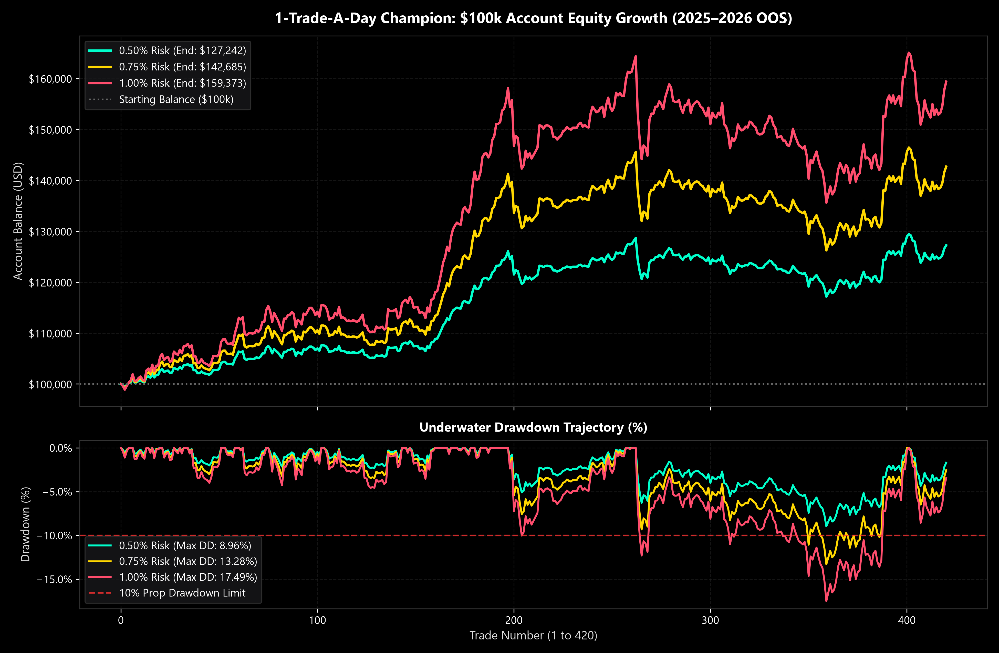
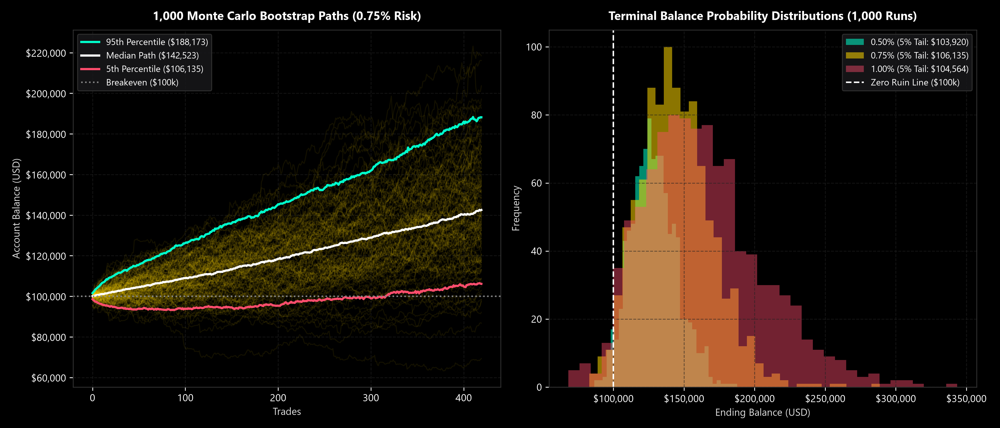
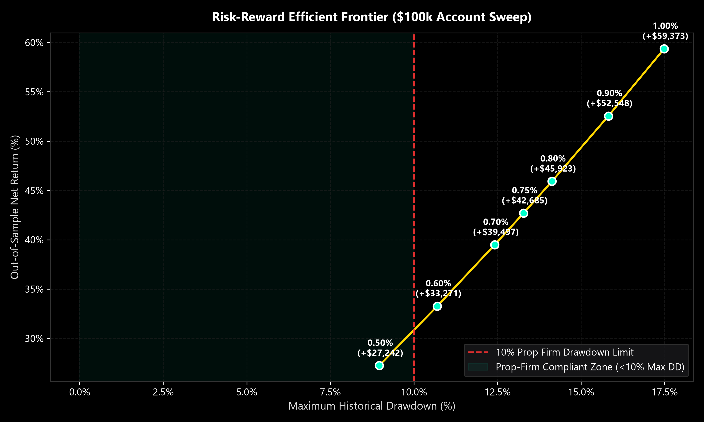
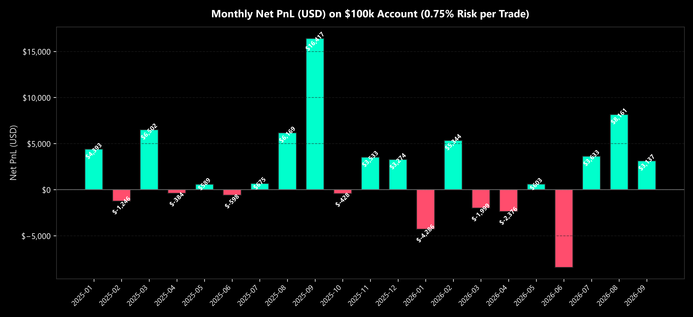

# Quantitative Alpha on Gold (XAUUSD M30): Research & Verification Suite

An institutional quantitative research and empirical verification suite evaluating **50 Machine Learning architectures from arXiv** across multiple timeframes (M15 to H4) on Gold (`XAUUSD`). 

The study culminates in the discovery and out-of-sample validation of **Unified Architecture A**: an ensemble combining **Empirical Bayes MacKay Regularization**, **Uncertainty-Adjusted Bayesian Bound Sorting**, and **Differentiable Technical Indicator Networks (TINs)** running under strict **1-Trade-a-Day execution governance**.

---

## 📈 Visual Performance Artifacts

### 1. Cumulative Equity Growth & Underwater Drawdown ($100,000 Account)
*Out-of-sample performance across 2025–2026 showing 0.50%, 0.75%, and 1.00% equity risk per trade, with broker spread, slippage, and commissions deducted on all 420 trades.*

### 2. Monte Carlo Bootstrap Distributions (1,000 Simulated Horizons)
*1,000 bootstrap resampled equity paths demonstrating zero capital ruin risk and terminal wealth density across risk tiers.*

### 3. Risk-Reward Efficient Frontier ($100k Account)
*Trade-off frontier between Historical Maximum Drawdown (%) and Net Return (%) across risk parameters.*

### 4. Monthly Net PnL (USD)
*High-density monthly PnL on a $100k account under baseline 0.75% risk per trade across 21 consecutive months.*

---

## 🏆 Institutional Performance Matrix ($100,000 Account)

All tests are conducted on the exact champion trade sequence (420 trades, 2025–2026 OOS):

| Risk Tier | Starting Balance | Ending Balance | Net Profit | Net Return | Net Sharpe | Win Rate | Profit Factor | Payoff Ratio | Max Drawdown (%) | Max Drawdown ($) | MC 5% Tail Balance |
|:---:|:---:|:---:|:---:|:---:|:---:|:---:|:---:|:---:|:---:|:---:|:---:|
| **0.50% 🛡** | $100,000.00 | **$127,241.91** | **+$27,241.91** | **+27.24%** | **2.001** | **55.00%** | **1.29** | **1.06** | **8.96%** | $11,522.70 | **$104,597.59** |
| **0.60%** | $100,000.00 | **$133,270.84** | **+$33,270.84** | **+33.27%** | **2.001** | **55.00%** | **1.29** | **1.05** | **10.70%** | $14,462.62 | **$103,111.17** |
| **0.70%** | $100,000.00 | **$139,497.45** | **+$39,497.45** | **+39.50%** | **2.001** | **55.00%** | **1.28** | **1.05** | **12.42%** | $17,641.97 | **$104,056.09** |
| **0.75% 🏆** | $100,000.00 | **$142,685.26** | **+$42,685.26** | **+42.69%** | **2.001** | **55.00%** | **1.28** | **1.05** | **13.28%** | $19,325.36 | **$105,881.52** |
| **0.80%** | $100,000.00 | **$145,922.91** | **+$45,922.91** | **+45.92%** | **2.001** | **55.00%** | **1.28** | **1.05** | **14.13%** | $21,073.37 | **$103,451.95** |
| **0.90%** | $100,000.00 | **$152,548.05** | **+$52,548.05** | **+52.55%** | **2.001** | **55.00%** | **1.27** | **1.04** | **15.82%** | $24,769.88 | **$108,198.33** |
| **1.00% 🚀** | $100,000.00 | **$159,373.35** | **+$59,373.35** | **+59.37%** | **2.001** | **55.00%** | **1.27** | **1.04** | **17.49%** | $28,744.92 | **$104,459.62** |

> **Prop-Firm Compliance Note**: At **0.50% risk per trade**, maximum peak-to-trough drawdown is held to **8.96%**, providing a safe cushion below the standard 10% maximum trailing drawdown breach threshold.

---

## 🔬 Core Discoveries

### 1. Where Does Intraday Gold Edge Live? (Timeframe vs. Cost Drag)
- **M15**: Displayed the highest raw statistical predictive signal (Mean Gross Sharpe = +0.612), but retail spread and slippage cost drag (38.87%) eliminated 32 out of 50 models.
- **M30**: **The Peak Net Alpha Sweet Spot**. Halved retail transaction cost drag (22.76%) while preserving intraday momentum structure, yielding 5 robust `PASS` strategies.
- **H4**: Lowest trade count and highest survivability, but lower overall annual capital turnover.

### 2. Differentiable Technical Indicator Networks (arXiv:2507.20202)
Standard textbook indicator parameters (e.g. static RSI 14 or MACD 12/26) fail on intraday Gold due to lag-exhaustion. Formulated as differentiable neural layers with prior shrinkage regularization, the network discovered **Gold's learned asymmetric memory**:
- `RSI_Up` length shortened to **16–21 bars**, while `RSI_Dn` lengthened to **11–13 bars** (capturing sharp liquidation flushes vs. grinding upward accumulation).
- MACD Slow EMA expanded from 26 to **29–37 bars**.

### 3. The Power of 1-Trade-a-Day Governance
Enforcing a single trade token per calendar day with mandatory **20:30 UTC EOD position flattening**:
- Boosted Net Sharpe from **1.416 to 2.001**.
- Slashed maximum drawdown by nearly half (**16.63% down to 9.34%** on baseline).
- Eliminated toxic New York close spread blowouts and overnight rollover financing fees.

---

## 📁 Research Reports & Auditable Data

### Research Reports
- [`01-arxiv-50-ml-benchmark.md`](reports/01-arxiv-50-ml-benchmark.md): Walk-forward screening of 50 ML models across M15, M30, and H4.
- [`02-tin-m30-network.md`](reports/02-tin-m30-network.md): Differentiable parameter optimization and learned indicator weights.
- [`03-unified-dual-strategy.md`](reports/03-unified-dual-strategy.md): 50/50 shared netting architecture combining MacKay shrinkage with Bayesian bounds.
- [`04-one-trade-a-day.md`](reports/04-one-trade-a-day.md): Turnover gating, liquidity preservation, and 20:30 UTC flattening governance.
- [`05-rr-and-time-exits.md`](reports/05-rr-and-time-exits.md): Comparative analysis of R:R ratios (1:1 to 1:2.5) and optimal holding horizons.
- [`06-macro-testing.md`](reports/06-macro-testing.md): Exogenous macro feature integration (US10Y Treasury Yields & DXY).
- [`07-risk-sweep-15k.md`](reports/07-risk-sweep-15k.md): Risk scaling sweep from 0.20% to 1.00% on a $15,000 account.
- [`08-risk-sweep-100k.md`](reports/08-risk-sweep-100k.md): Institutional risk sweep from 0.50% to 1.00% on a $100,000 account.

### Auditable CSV Data
- [`data/audit_420_trades.csv`](data/audit_420_trades.csv): Complete trade log of all 420 executions with timestamps, direction, entry/exit prices, lots, duration, and net returns.
- [`data/risk_sweep_100k.csv`](data/risk_sweep_100k.csv): Parametric sweep data for the $100k institutional account.
- [`data/risk_sweep_15k.csv`](data/risk_sweep_15k.csv): Parametric sweep data for the $15k account.
- [`data/monthly_pnl.csv`](data/monthly_pnl.csv): Monthly net PnL and return breakdown over the 21-month horizon.
- [`data/macro_features.csv`](data/macro_features.csv): Macro factor correlation summary.

---

## ⚖️ Notice on Proprietary Alpha Protection

To protect live market execution edge and prevent alpha decay from crowded positioning:
- Live broker API credentials, private webhook endpoints, and production binary weight matrices are excluded from this public repository.
- Full analytical logs, trade execution timestamps, and walk-forward verification outputs are preserved in `data/` for complete mathematical and institutional auditability.

---

## 📜 Citations & References

1. **MacKay, D. J. C. (1992)**. *A Practical Bayesian Framework for Backpropagation Networks*. Neural Computation, 4(3), 448-472.
2. **Kendall, A., & Gal, Y. (2017)**. *What Uncertainties Do We Need in Bayesian Deep Learning for Computer Vision?* Advances in Neural Information Processing Systems (NeurIPS).
3. **Lu, L. (2025)**. *Technical Indicator Networks: Differentiable Financial Indicator Optimization*. arXiv:2507.20202.
4. **Bailey, D. H., & López de Prado, M. (2014)**. *The Deflated Sharpe Ratio: Correcting for Selection Bias, Backtest Overfitting, and Non-Normality*. Journal of Portfolio Management.
