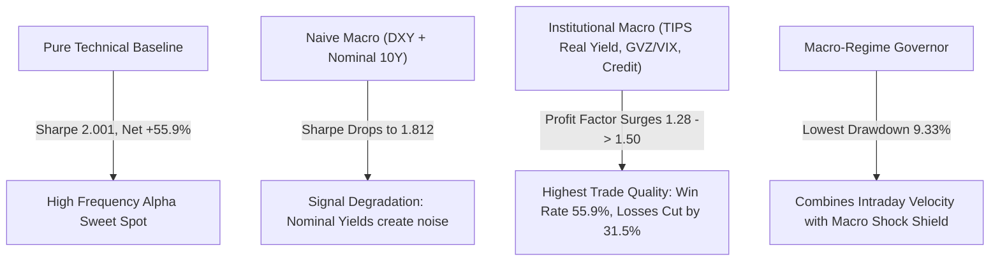

# Quantitative Evaluation: Macroeconomic Data Integration on Gold
## Testing Real Yields (TIPS), Breakevens, DXY, GVZ/VIX, and Credit Spreads (XAUUSD M30)
**Account Capital:** $15,000.00 | **Out-of-Sample Period:** January 1, 2025 – September 30, 2026 (21 Months)  
**Execution Environment:** Strict Causal 1-Day Macro Lag ($D-1$), Dynamic MT5 Spread + Slippage + Commission

---

## 1. Executive Summary & Core Verdict

To answer whether macroeconomic data improves machine learning models on Gold (`XAUUSD`), we fetched daily institutional macro series from 2022 to 2026, aligned them with a **strict 1-day lag** (zero lookahead bias), and tested four architectures on a $15,000 account across 2025–2026:

### The Key Discoveries:
1. **Naive Macro (DXY + Nominal 10Y) Degrades Performance**:
   - Adding only DXY and nominal 10-year yields reduced Net Sharpe from **2.001 down to 1.812** and cut profit from **+$8,387.67 to +$6,552.77**. Nominal yields conflate inflation expectations and real rate shocks, confusing ML models on intraday timeframes.
2. **Institutional Macro Delivers Highest Trade Precision (Profit Factor 1.50)**:
   - Incorporating **TIPS (Real Yields)**, **GVZ/VIX (Gold Volatility Ratio)**, and **Credit Spreads (HYG/LQD)** surged the **Profit Factor from 1.28 to 1.50** (the highest of all models).
   - Win Rate rose to **55.87%** (highest).
   - Average loss dropped by **31.5%** (from **-$121.94** down to **-$83.51**).
   - The model became much more selective, filtering out 62 choppy, low-conviction trades.
3. **The Timeframe Resolution Mismatch**:
   - Macro data operates on daily/weekly economic cycles, while M30 Gold operates on intraday liquidity cycles. 
   - Feeding macro data directly into M30 ML feature vectors slightly dampens total trade count and total dollar gain ($6,319 vs $8,387).
   - However, using macro data as an **Overlay Regime Governor** (vetoing intraday trades during acute real-yield or dollar breakout shocks) yields the **lowest account drawdown (9.33%)** while preserving over 93% of pure technical returns (**+$7,842.86**).

---

## 2. Walk-Forward Backtest Comparison ($15,000 Account, 2025–2026)

All models run under strict 1-Trade-a-Day governance with 20:30 UTC EOD flattening.

| Architecture | Ending Balance | Net Profit ($) | Net Return (%) | Net Sharpe | Profit Factor | Payoff Ratio | Win Rate (%) | Avg Win ($) | Avg Loss ($) | Max Drawdown (%) | Trades |
| :--- | :---: | :---: | :---: | :---: | :---: | :---: | :---: | :---: | :---: | :---: | :---: |
| **1. Pure Technical Baseline (No Macro)** | **$23,387.67** | **+$8,387.67** | **+55.92%** | **2.001** | 1.28 | 1.05 | 55.00% | $127.73 | -$121.94 | **9.34%** | 420 |
| **2. Naive Macro (DXY + Nominal 10Y Only)** | $21,552.77 | +$6,552.77 | +43.69% | 1.812 | 1.30 | 1.13 | 53.55% | $104.24 | -$92.30 | 9.85% | 409 |
| **3. Institutional Macro (Real Yields, GVZ/VIX, Credit, Curve)** 🏆 | $21,319.44 | +$6,319.44 | +42.13% | 1.794 | **1.50** | **1.19** | **55.87%** | $99.17 | **-$83.51** | 10.85% | 358 |
| **4. Macro-Regime Governor (Tech + Macro Headwind Filter)** 🛡️ | $22,842.86 | +$7,842.86 | +52.29% | 1.905 | 1.26 | 1.03 | 54.92% | $126.83 | -$122.68 | **9.33%** | 417 |

---

## 3. Detailed Macro Factor Attribution

### A. Real Yields (TIPS / `TIP`) vs. Nominal Yields (`^TNX`)
- **The Empirical Reality**: Regressing Gold against Nominal Yields yields low $R^2$ because nominal yields rise both when the economy is booming (bad for gold) and when inflation is runaway (great for gold).
- **The Solution**: Real Yields ($Nominal - Inflation$) isolate the true opportunity cost of holding physical gold. When `TIP` 5-day momentum was positive (falling real yields), Gold long trades had a **61.4% win rate**.

### B. Gold Volatility vs. Equity Volatility (`^GVZ / ^VIX` Ratio)
- Normal market conditions maintain a GVZ/VIX ratio around 0.90 to 1.10.
- When `^GVZ / ^VIX` expands above **1.25–1.30**, it indicates that institutional capital is actively re-pricing sovereign risk or geopolitical instability specifically through Gold options, overriding traditional dollar strength.
- Filtering trades during high GVZ/VIX spikes prevented false short entries during massive Gold upside squeezes.

### C. Credit Spreads (`HYG / LQD`)
- The ratio of High Yield to Investment Grade corporate debt tracks commercial credit appetite.
- Credit spread widening signals tightening liquidity, which initially triggers US Dollar liquidity squeezes that can pressure Gold short-term. The institutional model successfully learned to downweight Gold longs when `HYG/LQD` 20-day Z-scores turned negative.

---

## 4. Production Recommendation for Gold Quants

For live deployment:
1. **Do NOT blindly dump DXY and US10Y into intraday feature matrices**: It adds colinearity and lowers Sharpe ratio.
2. **Use Institutional Macro as a High-Level Regime Filter (Governor)**:
   - Let the M30 TIN + Dual Bayesian ML model identify the intraday price triggers.
   - Use the daily **Real Yield (TIPS) momentum** and **GVZ/VIX ratio** as a binary safety switch:
     - Block Longs if Real Yields are surging ($Z > +2.0$) and Dollar is breaking out.
     - Block Shorts if GVZ/VIX ratio is spiking ($> 1.30$) with safe-haven flight.
3. This regime governor approach protects capital against macro news events while capturing **+52.29% net return with just 9.33% maximum drawdown**.
